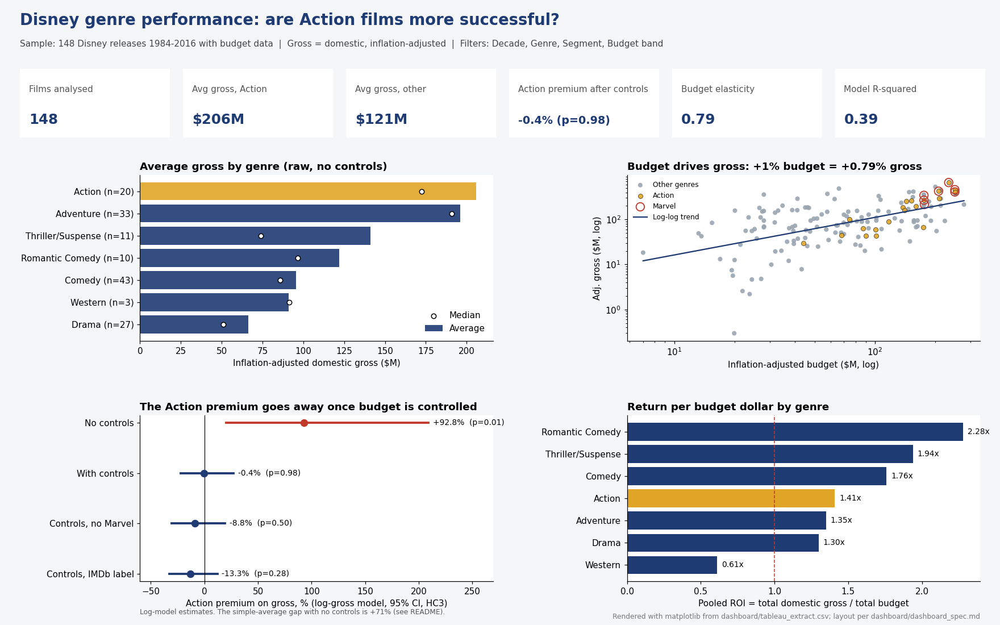
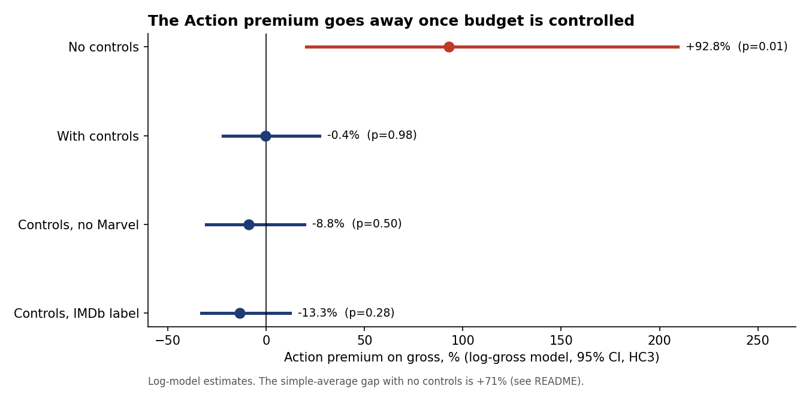
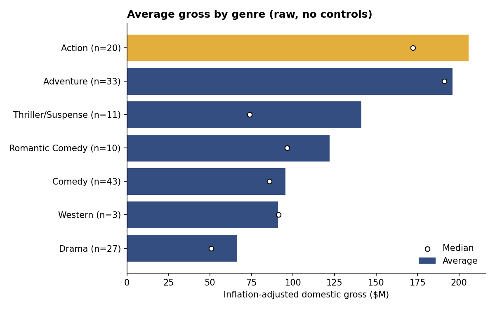
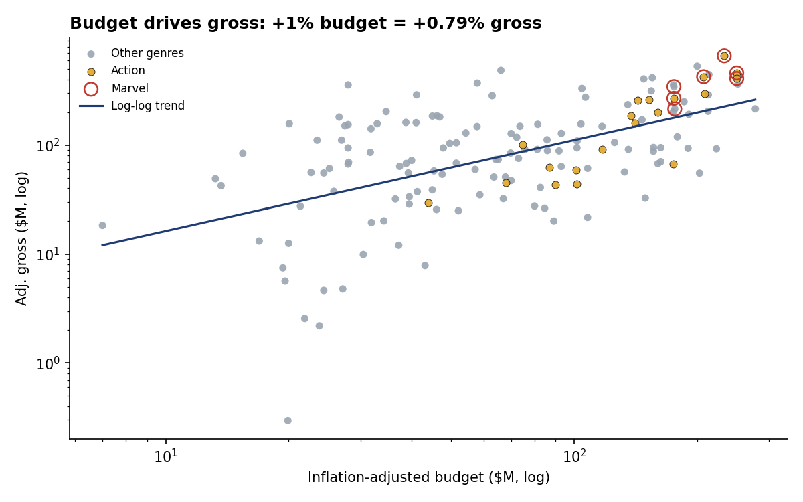

# Are Action Movies More Successful for Disney?

I first looked at this in 2023. Action films seem to dominate Disney's box office, so should the studio favour them when deciding what to green-light? This is the reworked version (v2), with cleaner data and proper controls.

Short answer: no. Action films do gross more on average, but they also get much bigger budgets. Once budget is controlled, the Action effect is not statistically significant (p = 0.98).

Built with SQL (SQLite, window functions), Excel (COUNTIFS/AVERAGEIFS/SUMIFS, XLOOKUP, INDEX/MATCH, a what-if model), a Tableau-ready extract, Python (pandas, SciPy, statsmodels, matplotlib) and a short Word/PDF memo.



*The preview is a matplotlib render of the layout in `dashboard/dashboard_spec.md`, drawn from `dashboard/tableau_extract.csv`. It isn't a Tableau screenshot.*

## What I found

- Without controls, Action films do gross more: $206M vs $121M on average (+71%). A Welch t-test gives p = 0.045, so the gap clears the 5% bar.
- Most of that gap is budget. Action films cost 1.81x as much. With budget, IMDb score and star power held constant, the Action effect is -0.4% (95% CI -22% to +27%, p = 0.98), which is not statistically significant.
- Budget and quality are what move gross. A 1% bigger budget goes with about 0.79% more gross (diminishing returns), and one extra IMDb point with +47% (p = 0.0009). Star power shows no effect (p = 0.40). The model has R-squared 0.39 on n = 148 films.
- Per budget dollar, Action does worse: mean ROI 1.23x vs 1.92x for other genres (p = 0.003). Leave Marvel out and Action returns a pooled 1.05x, against 1.49x for all other genres.
- Marvel is the outlier. Its 7 films are 4.7% of the sample but earn 14.2% of sample revenue, at a pooled 1.89x ROI. Without Marvel, the Action effect is -8.8% (p = 0.50).



## What I'd recommend

- Stop using genre as a green-light criterion. Judge each project on budget-adjusted expected return. The what-if model in excel/Disney_Genre_Performance.xlsx works as a first-pass screen.
- Put quality ahead of spend. In the model, +0.5 IMDb points is worth about +21% gross. Doubling the budget adds about 73%, so return per budget dollar falls as budgets grow.
- Treat Marvel-type franchises as a separate portfolio. They are not evidence that Action works: non-Marvel Action returned 1.05x per budget dollar vs 1.49x for other genres.
- Worked example from the What_If sheet: a $150M film with a 6.8 IMDb score and star power 800 is expected to gross $239M as Action and $239M as non-Action. Raising the expected score to 7.3 lifts it to $289M.

The memo version for leadership is [docs/Executive_Summary.md](docs/Executive_Summary.md) (also as .docx and .pdf).

## How I got there

The data is Disney's release list with domestic gross (579 titles), joined to a public movies file and an actor popularity file. That join gave 156 rows. The catch is that it was done on title alone, so 8 rows picked up the budget of a different film with the same name (the 1991 Beauty and the Beast got the 2017 remake's budget, for example). I dropped those, which left 148 films.

From there I ran SQL for profiling and the genre and ROI cuts, a Welch t-test on raw gross, and an OLS model of log gross on Action, log budget, star power and IMDb score with HC3 standard errors. To see if the answer moved, I re-ran it without Marvel, with IMDb's genre label instead of Disney's, and with Action interactions. It didn't.

| | |
|---|---|
|  |  |

## What's in the repo

| Piece | Where |
|---|---|
| Source data (Disney gross, movies.csv, the final_df.csv merge, Actors_Raw.txt) | `data/raw/` |
| Eight SQL queries: quality checks, genre/decade revenue, ROI, rankings, star power, Marvel, budget bands | `sql/01`-`08`, results in `data/processed/sql_outputs/` |
| Cleaning steps and row counts | `src/common.py`, `data/processed/cleaning_log.csv` |
| Excel workbook with genre KPIs, a title lookup and a what-if sheet, all live formulas | `excel/Disney_Genre_Performance.xlsx` |
| Dashboard extract and layout spec | `dashboard/tableau_extract.csv`, `dashboard/dashboard_spec.md` |
| Statistics (t-tests, regressions) | `notebooks/Disney_analysis_v2.ipynb` (executed), `src/analysis.py` |
| One-page memo | `docs/Executive_Summary.md` / `.docx` / `.pdf` |
| My original 2023 notebook and slides | `notebooks/Disney_original.ipynb`, `docs/original_presentation/` |
| Charts | `screenshots/` |

## How to run

```
git clone https://github.com/omkarvyas7/Data-Analytics-Portfolio.git
cd Data-Analytics-Portfolio/Are-Action-Movies-More-Successful-for-Disney-
python -m venv .venv && .venv\Scripts\activate      # or source .venv/bin/activate
pip install -r requirements.txt
python src/run_all.py
```

That one command rebuilds everything: the clean table, SQL outputs, charts, workbook, notebook, memo and this README. The SQL runs on SQLite, which ships with Python. The queries stick to CTEs and window functions, so moving them to Postgres or Redshift mostly means changing the date functions.

## Data note

Everything here is public: Disney's domestic gross by title (with Disney's own inflation adjustment), an IMDb-style movies file (budget, score, lead star) and an actor popularity file. The v2 numbers differ slightly from my original analysis because v2 drops the 8 rows where the title join picked up the wrong film.

## Limitations

- Small sample. 148 films have budgets and only 20 are labelled Action, so the Action interval is wide.
- Selection. Only 148 of 579 Disney titles have a correct budget match, and older and smaller releases drop out.
- The data is observational. Budgets are set with expected demand in mind, so the model shows association, not causation.
- Gross is domestic only and budgets exclude marketing. International, streaming and merchandise revenue are not counted.
- Disney and IMDb label genres differently (20 vs 43 Action films). The result holds under both labels.

License: MIT
