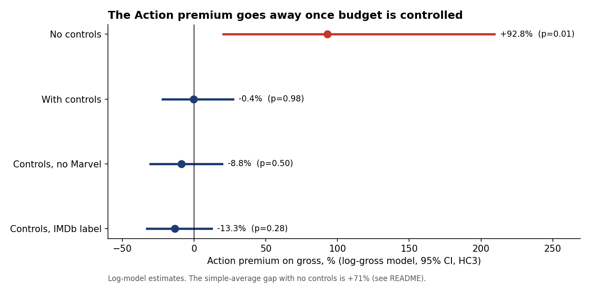

# Executive summary: Are Action movies more successful for Disney?

**To:** Studio leadership, green-light committee  
**From:** Business analytics  
**Scope:** 148 Disney releases, 1984-2016, with budget data. Gross is domestic, inflation-adjusted.

## Bottom line
Action films earn more at the box office because Disney spends more on them. At comparable budget, quality and star power, Action adds no detectable premium (-0.4%, p = 0.98), and it returns less per budget dollar. Green-light decisions should rest on budget-adjusted expected return and quality, not on genre.

## Findings
1. Without controls, Action films do gross more: $206M vs $121M on average (+71%). A Welch t-test gives p = 0.045, so the gap clears the 5% bar.
2. Most of that gap is budget. Action films cost 1.81x as much. With budget, IMDb score and star power held constant, the Action effect is -0.4% (95% CI -22% to +27%, p = 0.98), which is not statistically significant.
3. Budget and quality are what move gross. A 1% bigger budget goes with about 0.79% more gross (diminishing returns), and one extra IMDb point with +47% (p = 0.0009). Star power shows no effect (p = 0.40). The model has R-squared 0.39 on n = 148 films.
4. Per budget dollar, Action does worse: mean ROI 1.23x vs 1.92x for other genres (p = 0.003). Leave Marvel out and Action returns a pooled 1.05x, against 1.49x for all other genres.
5. Marvel is the outlier. Its 7 films are 4.7% of the sample but earn 14.2% of sample revenue, at a pooled 1.89x ROI. Without Marvel, the Action effect is -8.8% (p = 0.50).

## Recommendation for green-lighting decisions
- Stop using genre as a green-light criterion. Judge each project on budget-adjusted expected return. The what-if model in excel/Disney_Genre_Performance.xlsx works as a first-pass screen.
- Put quality ahead of spend. In the model, +0.5 IMDb points is worth about +21% gross. Doubling the budget adds about 73%, so return per budget dollar falls as budgets grow.
- Treat Marvel-type franchises as a separate portfolio. They are not evidence that Action works: non-Marvel Action returned 1.05x per budget dollar vs 1.49x for other genres.
- Worked example from the What_If sheet: a $150M film with a 6.8 IMDb score and star power 800 is expected to gross $239M as Action and $239M as non-Action. Raising the expected score to 7.3 lifts it to $289M.

## Method
Disney's gross file was joined to a public movies file (budget, IMDb score, lead star) and an actor popularity file. In 8 rows the title matched a different film, usually a later remake, and those rows were dropped. A Welch t-test compared Action and non-Action gross. An OLS regression of log gross on Action, log budget, star power and IMDb score, with HC3 standard errors, separated the genre effect from budget. The model was re-run without Marvel, with IMDb's genre label and with Action interactions as sensitivity checks.

## Limitations
- Small sample. 148 films have budgets and only 20 are labelled Action, so the Action interval is wide.
- Selection. Only 148 of 579 Disney titles have a correct budget match, and older and smaller releases drop out.
- The data is observational. Budgets are set with expected demand in mind, so the model shows association, not causation.
- Gross is domestic only and budgets exclude marketing. International, streaming and merchandise revenue are not counted.
- Disney and IMDb label genres differently (20 vs 43 Action films). The result holds under both labels.

## Next steps
- Add worldwide gross and marketing spend to measure full return.
- Re-run quarterly as new releases close their theatrical window.
- Pilot the What_If screen on the next three green-light submissions and compare with actuals.
