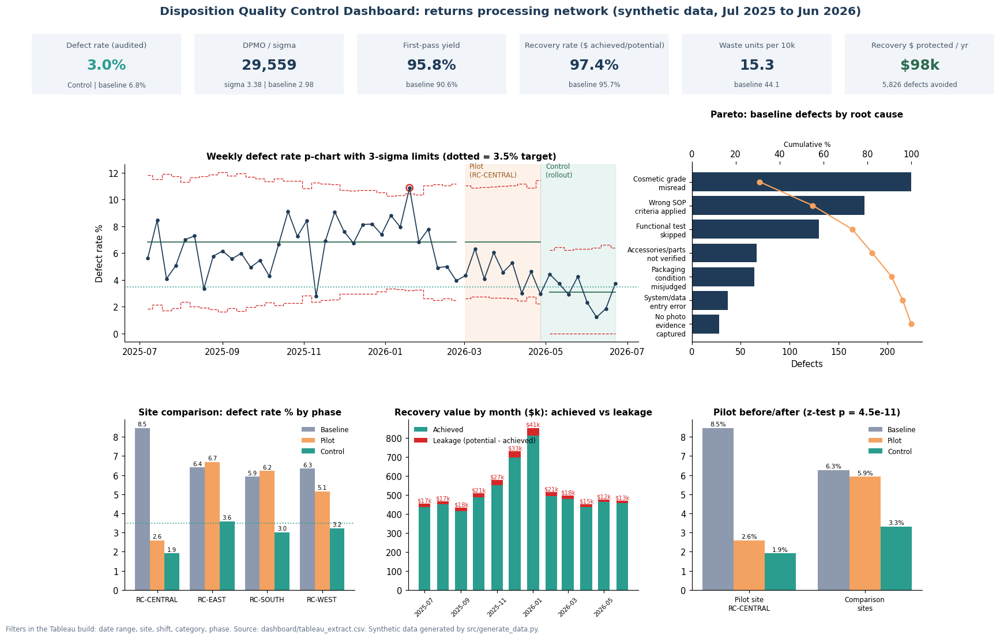
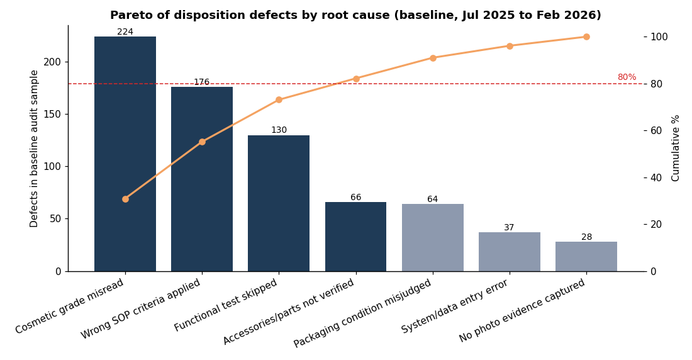
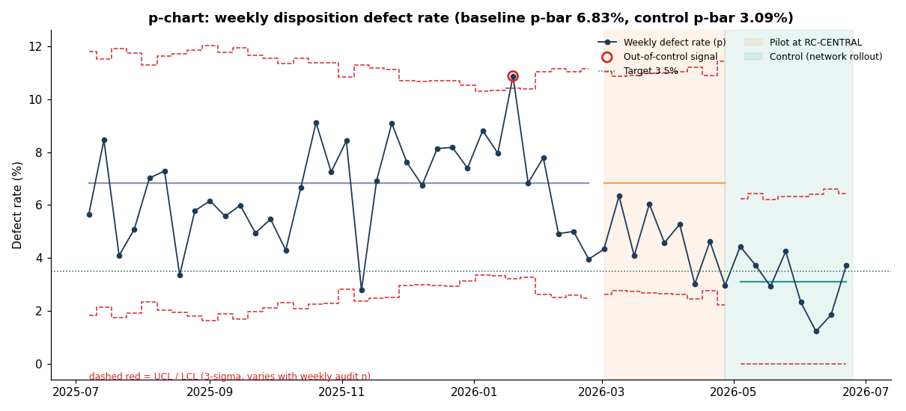
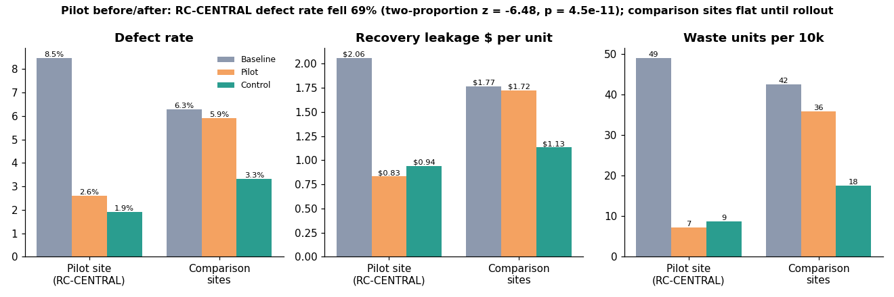
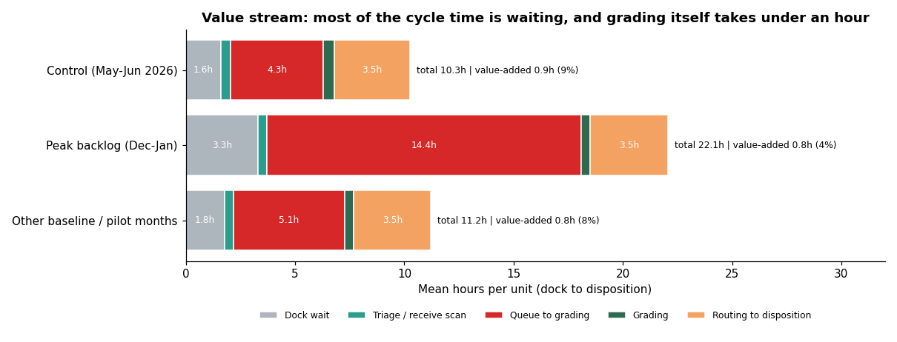

# DMAIC: Returns Processing Disposition Defect Reduction

When a returned item is graded wrong, it goes to the wrong place. A resellable item ends up in liquidation or the shredder, or a used one gets sold as new and comes back with a complaint. I wanted to run a full Lean Six Sigma DMAIC project on that problem, from the charter to the control plan, and see how far the disposition defect rate could come down.

The six dispositions are new, open-box, refurbish, liquidate, recycle and destroy. I used SQL (SQLite, CTEs, window functions), Python (pandas, statsmodels, scipy, matplotlib), Excel (COUNTIFS/SUMIFS, INDEX-MATCH, XLOOKUP, conditional formatting, a scenario tab), a Tableau/QuickSight extract, Word/PDF write-ups and a Jupyter notebook.



## What I found

- At baseline, 6.8% of 10,636 audited units got the wrong disposition. That works out to DPMO 68,165, about 2.98 sigma, with a first-pass yield of 90.6%. Over 8 months the misgrades cost $195,203 in recovery value and sent 468 resellable units to recycle or destroy.
- A logistic regression backed up six drivers. Associates in their first 30 days had the biggest effect (odds ratio 2.42), followed by items that were truly open-box (1.92), Electronics (1.66), no photo-grading step (1.54), night shift (1.41) and the Dec-Jan backlog (1.31). On the Pareto, the top 3 causes cover 73.1% of defects.
- The pilot at RC-CENTRAL (SOP v3.0, a grading checklist and a photo step) cut that site's defect rate from 8.5% to 2.6% (two-proportion z = -6.48, p = 4.5e-11). The comparison sites barely moved over the same weeks (6.3% to 5.9%, p = 0.29), so seasonality doesn't explain it.
- After the network rollout the defect rate averaged 3.0%, under the 3.5% goal. Sigma went from 2.98 to 3.38, recovery rate from 95.7% to 97.4%, and waste from 44.1 to 15.3 units per 10k.
- Most of the cycle time is waiting. Triage and grading are only 8% of dock-to-disposition time. In the Dec-Jan peak the queue to grading grew to 14.4 h, and 195 of 212 days from Oct to Apr sat above the I-MR reference limit.

## What I'd recommend

Keep SOP v3.0, the checklist and the photo step as standard work, with the Returns QA Manager owning the control plan. At the Control-period rate that means about **5,826 fewer wrong dispositions** and **$98,483 of recovery value** a year ($16.90 of extra leakage per defect), plus about 435 fewer scrapped units and 783 fewer complaints.

Two things I'd try next, neither of which was piloted: a 2-week buddy period for Q4 seasonal hires (new hires ran at 13.2% against 6.8% overall), and opening flex grading stations once the backlog index passes 1.1.

## Charts

| Pareto of defect causes | p-chart with control limits |
|---|---|
|  |  |
| **Pilot before / after** | **Value-stream cycle time** |
|  |  |

Also: [fishbone](docs/fishbone_ishikawa.png), [I-MR chart](screenshots/imr_chart_cycle_time.png), [odds ratios](screenshots/defect_drivers_odds_ratios.png), [capability](screenshots/cycle_time_capability.png).

## What's in the repo

| Piece | Where |
|---|---|
| Synthetic raw data (units, stage times, audits, associates, sites, SOP versions, disposition values) | `data/raw/`, made by `src/generate_data.py` |
| Cleaning and SQLite load, with a log of every fix | `src/build_db.py`, `data/processed/data_quality_log.csv` |
| Define: charter (goal, scope, RACI, timeline), SIPOC, VOC/CTQ tree | `docs/01_Project_Charter.*`, `docs/02_SIPOC.*`, `docs/03_VOC_CTQ_Tree.*` |
| Measure and Analyze queries: baseline DPMO and sigma, Pareto, segments, cycle-time percentiles, leakage, waste, value stream | `sql/01`-`07`, `sql/10`, run by `src/run_sql.py` |
| Stats and charts: chi-square, logistic regression, two-proportion z-tests, difference-in-differences, p-chart, I-MR, capability | `src/analyze.py`, `screenshots/`, `notebooks/analysis.ipynb` |
| Improve: pilot vs comparison sites | `sql/08_pilot_pre_post.sql`, `data/processed/hypothesis_tests.csv` |
| Control: control plan, weekly p-chart feed, communication plan | `docs/06_Control_Plan.*`, `sql/09_weekly_control_chart_feed.sql`, `docs/07_Stakeholder_Communication_Plan.*` |
| Full write-up with an executive summary | `docs/05_DMAIC_Report.md` / `.docx` / `.pdf` |
| Dashboard requirements doc with acceptance criteria and metric definitions | `docs/04_Requirements_Disposition_QC_Dashboard.*` |
| Dashboard extract, spec and preview image | `dashboard/`, `screenshots/dashboard.png` |
| Excel tracker: COUNTIFS/SUMIFS pivots, INDEX-MATCH and XLOOKUP, p-chart limit formulas, RAG formatting, scenario tab | `excel/DMAIC_Defect_Tracker.xlsx` |

## Running it

```
python -m venv .venv
.venv\Scripts\activate          (macOS/Linux: source .venv/bin/activate)
pip install -r requirements.txt
python src/run_all.py
```

`run_all.py` rebuilds everything in order: data, SQLite database, SQL outputs, stats and charts, the Excel workbook, the dashboard extract and preview, the docs, and the executed notebook. The SQL is written for SQLite but sticks to CTEs and window functions, so moving it to Redshift or Postgres mostly means changing the date functions (the SQL headers note where).

## About the data

All data is synthetic (made by `src/generate_data.py` with a fixed seed). None of it comes from Amazon or any employer. It's shaped like e-commerce returns: 150,918 units over 12 months at 4 sites and 3 shifts, 194 anonymized associates, a ~10% QA audit sample, and a Q4 peak followed by a January backlog. I also added missing values, duplicates and other dirty records so the cleaning step had real work to do.

The catch with synthetic data is that I built the root causes into the generator, so the analysis is really a check that the methods find them. Site baseline defect rates came out at RC-CENTRAL 8.5%, RC-EAST 6.4%, RC-WEST 6.3% and RC-SOUTH 5.9%.
