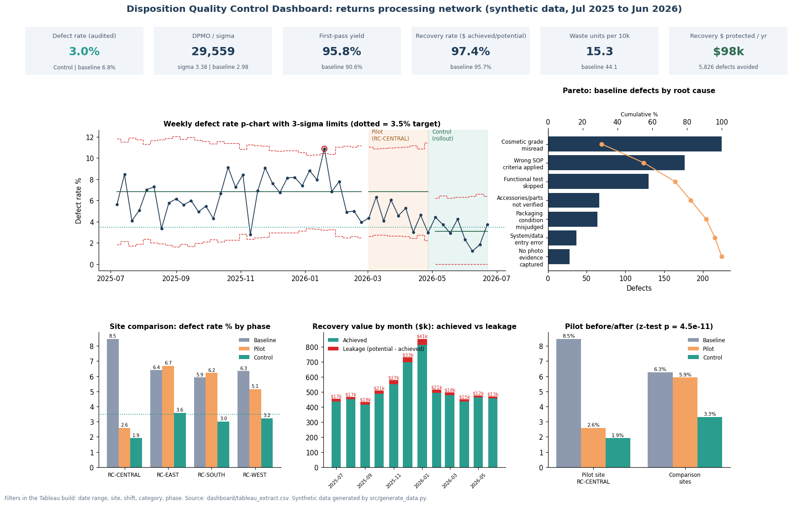
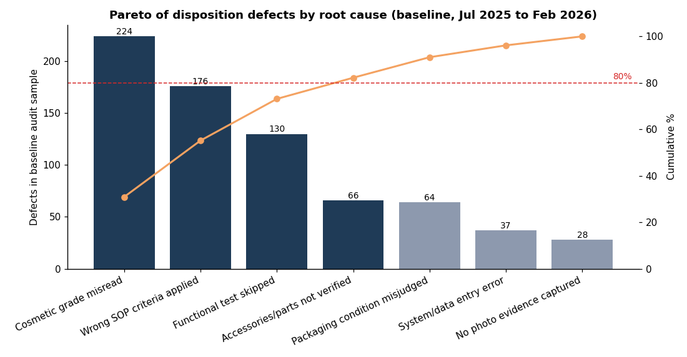
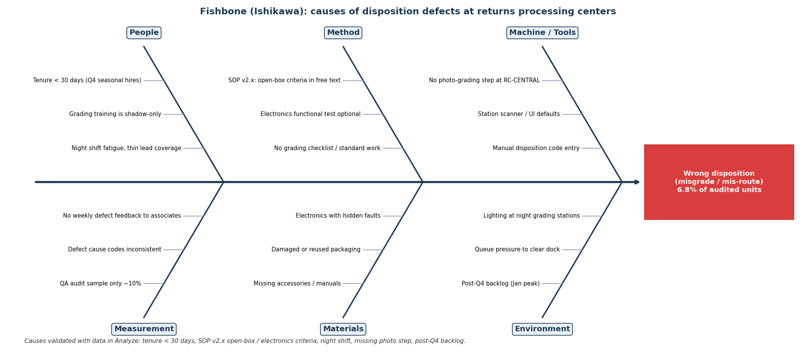
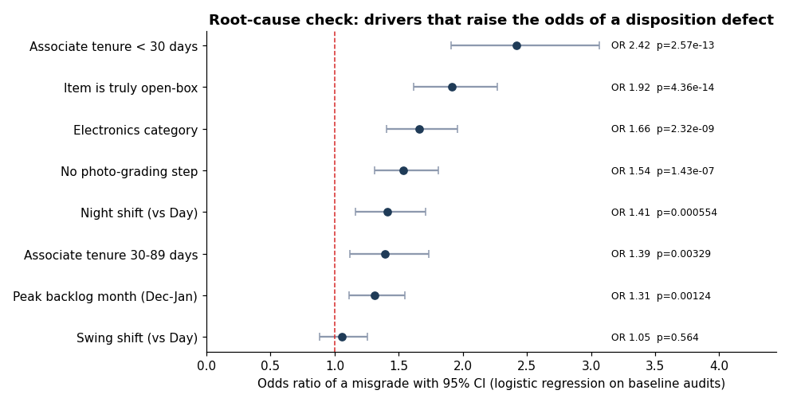
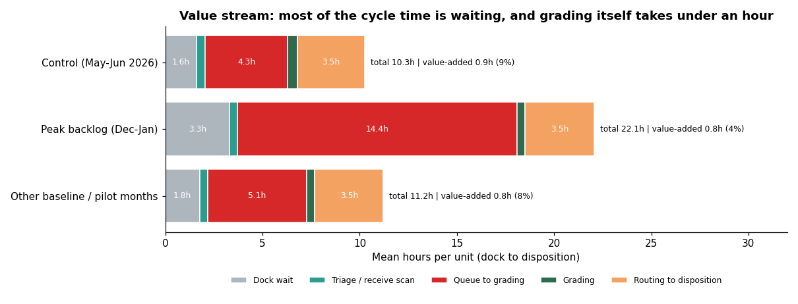
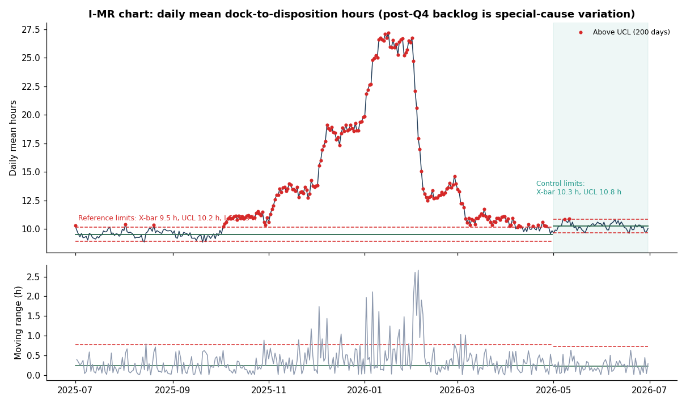
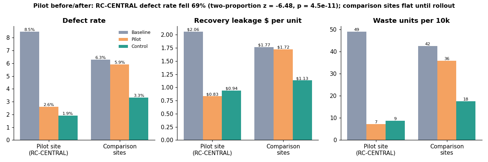
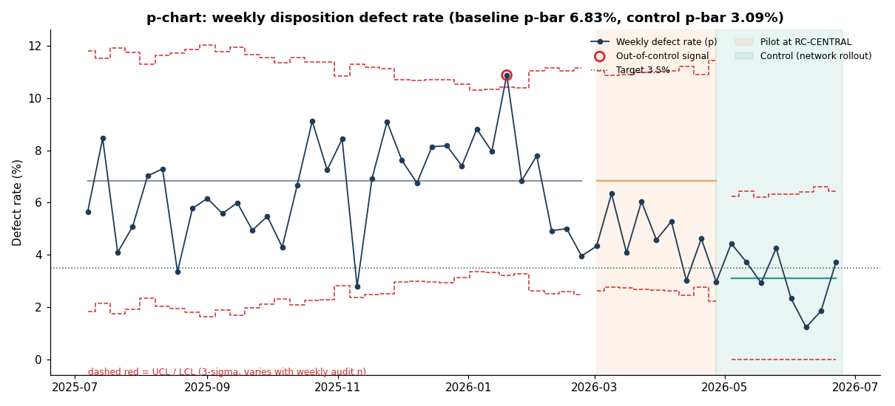
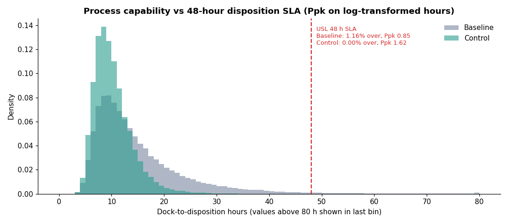

# DMAIC Report: Reducing Returns Disposition Defects

Project Lead: Omkar Vyas (personal project) | Period analysed: 1 Jul 2025 to 30 Jun 2026 | Data is synthetic, generated by `src/generate_data.py` to mirror e-commerce returns patterns. No Amazon or employer data is used.

## Executive summary

Returned items were graded into the wrong disposition 6.8% of the time (audited baseline, Jul 2025 to Feb 2026), or about 3.0 sigma. Each wrong call lost an average of $16.90 more recovery value than a correct one. Some sent resellable items to the shredder, and others shipped used items as new.

Four causes explained most of the problem: new associates in their first 30 days, an unclear grading SOP for open-box and electronics, the night shift, and a missing photo-grading step at RC-CENTRAL. The January backlog after peak season made all of them worse.

Three fixes were piloted at RC-CENTRAL in March and April 2026: SOP v3.0 with a visual open-box / electronics grading matrix, an 8-point grading checklist, and a mandatory photo step. The pilot site's defect rate fell from 8.5% to 2.6% (p = 4.5e-11), while the other sites stayed flat (6.3% to 5.9%). After the network rollout in May, the network defect rate averaged **3.0%**, below the 3.5% goal.

What it means for the business, at current volume (150,918 units a year):

- About **5,826 fewer wrong dispositions** and **$98,483 of recovery value protected** a year.
- Recovery rate up from 95.7% to 97.4% of potential.
- Waste down from 44.1 to 15.3 resellable units scrapped per 10,000 (about 435 units a year).
- Customer complaints down from 1.21% to 0.69% of units (about 783 fewer a year).

Decisions requested:

1. Approve SOP v3.0, the checklist and the photo step as permanent standard work.
2. Fund a 2-week buddy period for Q4 seasonal hires. This is recommended but was not piloted.
3. Make the Returns QA Manager the owner of the control plan and dashboard.

## 1. Define

**Problem.** 6.8% of audited units got the wrong disposition. Over eight months $195,203 of recovery value leaked and 468 resellable units were scrapped.

**Goal.** Control-period defect rate at or below 3.5% by 30 June 2026, recovery rate at or above 97%, waste per 10k down at least 50%, mean cycle time at or below 12 hours. See `docs/01_Project_Charter.md`.

**Scope.** Grading and disposition at four returns centers, all shifts. Customers and CTQs are in `docs/02_SIPOC.md` and `docs/03_VOC_CTQ_Tree.md`.

## 2. Measure

**Data.** 150,918 units over 365 days, 15,689 QA audits (about 10%, or 20% at the pilot site during the pilot), 194 anonymized associates. Raw files were cleaned before analysis:

| table | check | rows |
|---|---|---|
| returns_units | raw rows | 151,098 |
| returns_units | duplicate unit rows removed | 180 |
| returns_units | category variants standardized | 400 |
| returns_units | negative prices corrected (abs) | 12 |
| returns_units | missing prices imputed (category median) | 350 |
| returns_units | missing shift derived from received hour | 250 |
| returns_units | clean rows | 150,918 |
| unit_cycle_stages | rows with negative stage time set to NULL | 25 |
| audits | duplicate audit rows removed | 15 |
| audits | orphan audits removed (no matching unit) | 8 |
| audits | clean rows | 15,689 |

**Operational definitions.** A defect is an audited unit whose assigned disposition differs from the auditor's disposition, with one opportunity per unit. DPMO = defects / audited units x 1,000,000. First-pass yield (FPY) = audited units correct and not sent back for re-grade / audited units. Sigma uses the conventional 1.5-sigma shift.

**Baseline and phase results (SQL: `sql/02_baseline_defect_rate_dpmo_sigma.sql`).**

| Phase | Site | Audited | Defects | Defect rate | DPMO | FPY | Sigma |
|---|---|---|---|---|---|---|---|
| Baseline | NETWORK | 10,636 | 725 | 6.8% | 68,165 | 90.6% | 2.98 |
| Baseline | RC-CENTRAL | 2,646 | 224 | 8.5% | 84,656 | 86.7% | 2.87 |
| Baseline | RC-EAST | 2,855 | 183 | 6.4% | 64,098 | 92.0% | 3.02 |
| Baseline | RC-SOUTH | 1,909 | 113 | 5.9% | 59,193 | 91.8% | 3.06 |
| Baseline | RC-WEST | 3,226 | 205 | 6.3% | 63,546 | 91.8% | 3.02 |
| Pilot | NETWORK | 2,854 | 133 | 4.7% | 46,601 | 93.3% | 3.17 |
| Pilot | RC-CENTRAL | 1,081 | 28 | 2.6% | 25,902 | 95.6% | 3.44 |
| Pilot | RC-EAST | 598 | 40 | 6.7% | 66,890 | 91.5% | 2.99 |
| Pilot | RC-SOUTH | 418 | 26 | 6.2% | 62,201 | 91.9% | 3.03 |
| Pilot | RC-WEST | 757 | 39 | 5.1% | 51,519 | 92.3% | 3.13 |
| Control | NETWORK | 2,199 | 65 | 3.0% | 29,559 | 95.8% | 3.38 |
| Control | RC-CENTRAL | 573 | 11 | 1.9% | 19,197 | 96.7% | 3.57 |
| Control | RC-EAST | 612 | 22 | 3.6% | 35,948 | 95.1% | 3.29 |
| Control | RC-SOUTH | 364 | 11 | 3.0% | 30,220 | 96.4% | 3.37 |
| Control | RC-WEST | 650 | 21 | 3.2% | 32,308 | 95.2% | 3.34 |

**Cycle time.** Baseline mean dock-to-disposition time was 15.1 h (p50 12.4 h, p95 32.6 h). 1.16% of baseline units exceeded the 48-hour SLA, and Ppk on log hours was 0.85. The daily mean peaked at 27.2 h on 2026-01-16.

**Measurement system.** Audit cause codes were reviewed with QA. An attribute agreement study between auditors is planned (target kappa at or above 0.8). Until then the audit result is the reference.

## 3. Analyze

**Pareto.** The top three causes (Cosmetic grade misread, Wrong SOP criteria applied, Functional test skipped) account for 73.1% of baseline defects.

| Cause | Defects | Share | Cumulative |
|---|---|---|---|
| Cosmetic grade misread | 224 | 30.9% | 30.9% |
| Wrong SOP criteria applied | 176 | 24.3% | 55.2% |
| Functional test skipped | 130 | 17.9% | 73.1% |
| Accessories/parts not verified | 66 | 9.1% | 82.2% |
| Packaging condition misjudged | 64 | 8.8% | 91.0% |
| System/data entry error | 37 | 5.1% | 96.1% |
| No photo evidence captured | 28 | 3.9% | 100.0% |

**Fishbone.** The team brainstormed causes across People, Method, Machine, Measurement, Materials and Environment, then tested the likely ones with data.

**Stratification (baseline).**

- Tenure: associates in their first 30 days misgraded 13.2% of audited units vs 6.0% for 365+ days. New hires handled 16.5% of audited units in November and December, when Q4 seasonal hires start.
- SOP clarity: Electronics ran at 9.9% vs a 6.8% network rate, and units whose correct disposition was open-box ran at 11.1%.
- Shift: night shift 8.8% vs 6.3% for day and swing (chi-square p = 7.6e-05).
- Photo step: units graded without a photo 8.7% vs 6.1% with one. RC-CENTRAL, the site without the step, ran at 8.5%.
- Backlog: January ran at 8.5% and December at 7.8%, vs 5.7% in July.
- Direction: 27.3% of baseline defects were upgrades (graded too high). The rest were downgrades that lose recovery value or create waste.

**Root-cause verification (logistic regression on 10,636 baseline audits).** Each driver was tested while holding the others constant. Every validated cause was significant at p < 0.01. Swing shift was not.

| Driver | Odds ratio | 95% CI | p-value | Share of baseline audits |
|---|---|---|---|---|
| Associate tenure < 30 days | 2.42 | 1.91 to 3.06 | 2.6e-13 | 6.8% |
| Item is truly open-box | 1.92 | 1.62 to 2.27 | 4.4e-14 | 18.8% |
| Electronics category | 1.66 | 1.41 to 1.96 | 2.3e-09 | 22.0% |
| No photo-grading step | 1.54 | 1.31 to 1.81 | 1.4e-07 | 27.8% |
| Night shift (vs Day) | 1.41 | 1.16 to 1.71 | 5.5e-04 | 20.0% |
| Associate tenure 30-89 days | 1.39 | 1.12 to 1.74 | 3.3e-03 | 12.9% |
| Peak backlog month (Dec-Jan) | 1.31 | 1.11 to 1.55 | 1.2e-03 | 35.1% |
| Swing shift (vs Day) | 1.05 | 0.88 to 1.26 | 5.6e-01 | 35.2% |

**Value stream.** In a normal month, triage and grading (the value-added steps) were only 8% of a 11.2-hour flow. In the Dec-Jan peak the queue to grading grew to 14.4 h and total time to 22.1 h. The I-MR chart shows the post-Q4 backlog as special-cause variation: 195 of 212 days from October to April sat above the reference UCL of 10.2 h.

## 4. Improve

**Solutions selected (impact vs effort).**

1. SOP v3.0: a visual grading matrix for open-box and electronics (addresses "Wrong SOP criteria applied" and "Functional test skipped").
2. 8-point grading checklist in the grading tool, including accessories and functional test (addresses "Accessories/parts not verified").
3. Mandatory photo capture before a disposition can be submitted (addresses "Cosmetic grade misread" at RC-CENTRAL).
4. Recommended but not piloted: a 2-week buddy period and Electronics certification for new hires, earlier Q4 seasonal hiring, and flex grading stations when the backlog index passes 1.1.

**Pilot design.** RC-CENTRAL, 1 Mar to 30 Apr 2026, with the audit rate raised to 20% for statistical power. The other three sites kept SOP v2.2 and served as the comparison group over the same weeks.

| Group | Phase | Audited | Defects | Defect rate | Leakage $/unit | Waste / 10k | Mean cycle h |
|---|---|---|---|---|---|---|---|
| Pilot site (RC-CENTRAL) | Baseline | 2646 | 224 | 8.5% | $2.06 | 49.1 | 15.8 |
| Pilot site (RC-CENTRAL) | Pilot | 1081 | 28 | 2.6% | $0.83 | 7.3 | 10.9 |
| Pilot site (RC-CENTRAL) | Control | 573 | 11 | 1.9% | $0.94 | 8.8 | 10.7 |
| Comparison sites | Baseline | 7990 | 501 | 6.3% | $1.77 | 42.5 | 14.8 |
| Comparison sites | Pilot | 1773 | 105 | 5.9% | $1.72 | 35.9 | 10.7 |
| Comparison sites | Control | 1626 | 54 | 3.3% | $1.13 | 17.5 | 10.1 |

**Hypothesis test.** H0: the pilot-site defect rate did not fall. Two-proportion z-test: z = -6.48, one-sided p = 4.5e-11. The rate fell by 69%, a change of -7.3 to -4.5 percentage points (95% CI). The comparison sites showed no significant change over the same weeks (p = 0.29). A difference-in-differences logistic model gives an interaction odds ratio of 0.31 (p = 3.2e-07), so the drop is not explained by seasonality alone.

## 5. Control

**Rollout.** SOP v3.0, the checklist and the photo step went live at all four sites on 1 May 2026.

**Result.** The network defect rate fell from 6.8% to 3.0% (z = -6.86, p = 3.5e-12). DPMO went from 68,165 to 29,559, sigma from 2.98 to 3.38 and FPY from 90.6% to 95.8%. The comparison sites fell from 5.9% in the pilot window to 3.3% after rollout (p = 1.7e-04), so the pilot result repeated at the other three sites.

**p-chart.** Limits were recalculated for the Control period: centre line 3.09% vs 6.83% at baseline (full weeks only). The Control period had 0 out-of-control signals in 8 full weeks. 4 of those weeks were at or below the 3.5% target. Weekly values bounce around because each week has only about 251 audits.

**Cycle time and capability.** Control mean 10.3 h, p95 17.0 h, 0.00% over the 48-hour SLA, Ppk 1.62 (baseline 0.85). Lower spring volume explains much of the cycle-time gain. The checklist has a small cost: mean grading time was 0.48 h per unit in Control vs 0.43 h in normal baseline months (value-stream chart).

**Control plan, dashboard and hand-off.** See `docs/06_Control_Plan.md` (10 metrics with limits, owners and reaction plans) and `docs/04_Requirements_Disposition_QC_Dashboard.md`. The weekly feed is `sql/09_weekly_control_chart_feed.sql`, and the Excel tracker is `excel/DMAIC_Defect_Tracker.xlsx`.

## 6. Financial impact (method)

Incremental leakage per defect = mean leakage on defective audited units - mean leakage on correct audited units (baseline) = $16.90. Annual benefit = annual units x (baseline rate - control rate) x incremental leakage = 150,918 x (6.82% - 2.96%) x $16.90 = **$98,483**. At exactly the 3.5% target the benefit would be $84,603. The figure excludes complaint handling cost, second-return processing and the value of waste avoided beyond recovery $, so it is a conservative estimate. The Excel Scenario tab lets Finance change the target and the inputs.

## 7. Limitations and next steps

- The data is synthetic. Effect sizes were built into the generator, and the analysis recovers them. A real project would also run an attribute agreement analysis on the auditors.
- The new-hire fix was not piloted, and the Control-period new-hire defect rate (4.9%) is based on only 61 audits.
- The next Q4 peak is the real test of the control plan. The reaction plan for a backlog index above 1.1 should be rehearsed in October.
