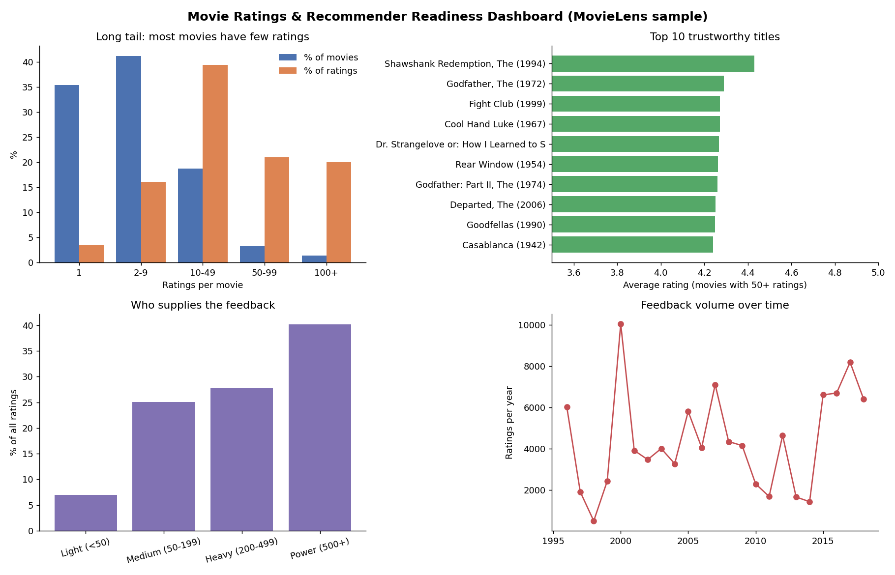

# Movie Recommendation System (kNN + cosine similarity)

I built an item-based recommender on the MovieLens sample, then went back and added SQL to check a simple question first: how much of the catalog has enough ratings to recommend from at all?

Stack: SQL (SQLite), Python (pandas, NumPy), matplotlib, Jupyter



The preview above is a matplotlib render built from the SQL outputs.

## What I found
- 100,836 ratings from 610 users across 9,724 movies. No null ratings, no duplicate user/movie pairs.
- 76.6% of movies have fewer than 10 ratings, so their averages don't mean much. I used a 50-rating cutoff for the model.
- Only 450 movies (4.6% of the catalog) clear that bar, but they carry 41% of all ratings.
- 44 users with 500+ ratings each account for 40.2% of the feedback. A handful of people shape a lot of the model.
- The neighbors look sensible. The closest match to The Godfather (1972) is The Godfather: Part II (cosine similarity 0.822).

## What I'd do with it
Use the kNN suggestions only for titles with 50+ ratings. For everything else, fall back to genre or popularity until there's more data. I'd also try down-weighting the very heavy raters, since they pull the similarities toward their own taste.

## How it works
1. Data checks in SQL: row counts, nulls, rating range, duplicates, ratings with no matching movie.
2. A few SQL views of the data: long-tail buckets, top titles (50+ ratings), user activity segments, ratings per year.
3. Keep movies with 50+ ratings and pivot to a movie x user matrix (450 x 606).
4. Cosine similarity between movie vectors, top 5 neighbors per movie.

## What's in the repo
| Piece | Where |
|---|---|
| Data checks | `sql/01_data_quality.sql` |
| Long tail and user segments | `sql/02_rating_count_buckets.sql`, `sql/04_user_activity_segments.sql` |
| Top titles, ratings by year | `sql/03_top_movies_min_50.sql`, `sql/05_ratings_by_year.sql` |
| Recommender and charts | `src/run_all.py` |
| Original notebook (scikit-learn kNN) | `notebooks/MovieRecommendationkNN.ipynb` |
| One-page summary | `docs/Project_Summary.md` |

```
data/raw/          movies.csv, ratings.csv
data/processed/    SQL outputs, knn_recommendations.csv, key_metrics.json
sql/               01-05
src/run_all.py     rebuilds everything
notebooks/         original notebook
screenshots/       dashboard.png + 4 charts
docs/              Project_Summary.md
```

## Running it
```
pip install -r requirements.txt
python src/run_all.py
```

The original notebook reads the CSVs from its own folder. If you want to re-run it, change the `read_csv` paths to `../data/raw/`.

## Data
[MovieLens ml-latest-small](https://grouplens.org/datasets/movielens/) from GroupLens Research (University of Minnesota), used under their terms for non-commercial research and education.
