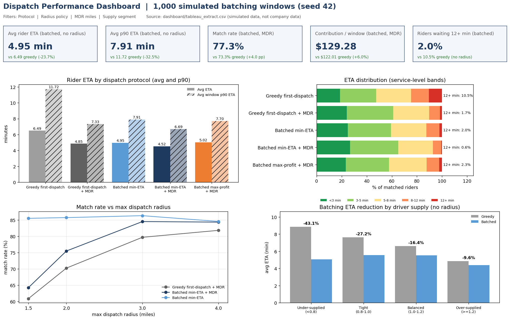

# Ride-Hailing Dispatch: First-Dispatch vs Batched Matching

Most ride-hailing apps started out sending each request to the nearest open driver, one at a time. I wanted to see how much rider wait time, unmatched demand and contribution that habit gives up compared with matching a short batch of requests all at once, and what an operations team would actually change.

Built with SQL (SQLite), Excel (SUMIFS / AVERAGEIFS / INDEX-MATCH what-if model), a Tableau-ready extract with a dashboard spec, Python (numpy, pandas, scipy, cvxpy) and a short memo plus requirements doc in Word / PDF.



*Preview rendered with matplotlib from `dashboard/dashboard_spec.md`. To rebuild it in Tableau Public, use `dashboard/tableau_extract.csv`.*

> All data is synthetic, generated with a fixed numpy seed (42). None of it comes from Uber or any other company, and this wasn't done at or for Uber. Uber is only the public example of the dispatch problem.

## What I found

I ran 1,000 simulated batching windows (14,795 rider requests) and put every protocol through the same riders and drivers.

- Batching cuts average rider ETA from 6.49 to 4.95 minutes (-23.69%). The average window p90 drops from 11.72 to 7.91 minutes (-32.53%). Match rate stays at 85.56%, same as greedy.
- The long-wait tail mostly goes away. Riders waiting 12+ minutes fall from 10.49% to 2.05% of matched riders, and drivers spend 62.66 unpaid en-route minutes per window instead of 82.12.
- Add a maximum dispatch radius and greedy starts stranding riders it could have served. Batching lifts match rate from 73.33% to 77.31% (+3.98 pp), lowers average ETA by 6.72% and adds 5.96% modelled contribution ($7.27 per window, $7,269 over 1,000 windows).
- The gain is biggest when drivers are scarce: 43.06% lower ETA in under-supplied windows (fewer than 0.8 drivers per rider) against 9.60% in over-supplied ones.
- A naive dashboard would flag 506 windows where batching looks worse on some KPI. Turns out none of them are real ETA regressions. 255 serve extra riders (so average ETA goes up by design), 85 only have a longer p90 tail, and 166 earn less contribution because the objective ignores fare.

## What I'd recommend

Switch from greedy first-dispatch to batched min-ETA assignment with a 3-mile maximum dispatch radius. Roll it out as a zone-level switch-back pilot and watch it on the Dispatch Performance Dashboard.

- Expected effect in the simulation: -23.69% average ETA and -32.53% p90 ETA at the same match rate. With the radius on, +3.98 pp match rate and +5.96% contribution per window.
- Why 3 miles: batching keeps an 84.54% match rate there (86.35% with no radius) at 4.89 minutes average ETA. At 1.5 miles match rate falls to 64.25%.
- A contribution-maximizing objective adds 12.01% contribution over greedy, but average ETA rises 3.66% versus greedy (radius enforced). I'd hold that for later.
- The full memo is in [docs/Executive_Summary_Dispatch_Recommendation.md](docs/Executive_Summary_Dispatch_Recommendation.md), with `.docx` and `.pdf` copies.

## How I approached it

I framed it loosely as DMAIC.

- Define: the gap in first-dispatch is the long-wait tail, stranded riders and deadhead time. KPI definitions are in the [requirements doc](docs/Requirements_Dispatch_Performance_Dashboard.md).
- Measure: `src/simulate.py` runs 1,000 seeded windows (6 x 6 mile zone, about 15 requests each, 0.6 to 1.5 drivers per rider, 1.5 to 4 mile radius). It records avg and p90 ETA, total en-route time, match rate, unmatched riders, share of drivers matched and contribution for five protocols.
- Analyze: seven SQL queries in `sql/` cover the scorecard, % change vs greedy, ETA bands, radius and supply sensitivity (CASE, CTEs, LAG / RANK) and a gap list that sorts flagged windows by cause.
- Improve: batched assignment uses `scipy.optimize.linear_sum_assignment`. I checked it against the notebook's cvxpy 0-1 integer program on 25 windows and got the same optima (`src/validate_ilp.py`).
- Control: the dashboard spec has metric definitions, filters and a daily refresh, and the gap classification keeps a pilot from being stopped on a false alarm.

The original notebook is in [notebooks/Uber_dispatch_optimization.ipynb](notebooks/Uber_dispatch_optimization.ipynb). It has four models: first-dispatch picking the minimum-ETA driver within a max radius, batched dispatch minimizing total ETA, batched dispatch maximizing profit within the radius, and push-notification time-slot scheduling that maximizes a predicted-response score under per-slot and total caps. Its results are unchanged (batch ETA 0.1015, batch profit 1322.7378, notification score 239.58).

## What's in the repo

| Piece | Where |
|---|---|
| SQL analysis | `sql/01` to `07`, run by `src/run_sql.py`. Outputs land in `data/processed/sql_*.csv` |
| Excel model | `excel/Dispatch_KPI_Model.xlsx`: Results table, Summary (COUNTIFS / SUMIFS / AVERAGEIFS), Sensitivity grids, Grid lookup, WhatIf inputs with data validation and INDEX/MATCH, conditional formatting, 5 native charts |
| Dashboard | `dashboard/tableau_extract.csv`, `dashboard/dashboard_spec.md`, `screenshots/dashboard.png` |
| Requirements doc | `docs/Requirements_Dispatch_Performance_Dashboard.md` / `.docx` (goals, RACI, testable FRs, metric definitions, risks, timeline) |
| Recommendation memo | `docs/Executive_Summary_Dispatch_Recommendation.md` / `.docx` / `.pdf`, including the pilot plan and go / no-go criteria |
| Simulation and checks | `src/simulate.py` (Monte Carlo), `src/validate_ilp.py` (ILP cross-check) |
| Original models | Integer programs in the notebook |

## Layout

```
Optimizing-Ride-Hailing-Services-Uber/
  README.md  LICENSE  requirements.txt  .gitignore
  data/raw/dispatch_windows.csv            simulated window inputs (demand, supply, radius)
  data/processed/                          simulation_results.csv, simulation_matches.csv, sql_*.csv, key_metrics.json
  sql/                                     01_kpi_by_protocol ... 07_gap_summary_by_segment
  src/                                     simulate, build_db, run_sql, validate_ilp, make_excel,
                                           make_dashboard, metrics, make_docs, run_notebook, run_all
  notebooks/Uber_dispatch_optimization.ipynb   original cvxpy integer programs (executed)
  excel/Dispatch_KPI_Model.xlsx
  dashboard/                               tableau_extract.csv, tableau_eta_distribution.csv, dashboard_spec.md
  docs/                                    executive summary (md, docx, pdf), requirements (md, docx)
  screenshots/                             dashboard.png + 4 charts
```

## Running it

```
python -m venv .venv
.venv\Scripts\activate          # macOS/Linux: source .venv/bin/activate
pip install -r requirements.txt
python src/run_all.py
```

`run_all.py` rebuilds the simulation, the SQLite database (`data/processed/dispatch_sim.db`, git-ignored), SQL outputs, Excel model, dashboard extract and PNGs, and the docs, then re-runs the notebook. Without cvxpy it skips the ILP cross-check and the notebook run and keeps the notebook's saved outputs. Excel formulas calculate when you open the workbook.

## Data and assumptions

- All data is synthetic (made by `src/simulate.py`, seed 42). None of it comes from Uber or any employer. Each window is a 6 x 6 mile zone with Manhattan distances, 18 mph average speed, lognormal traffic noise and a 1-minute pickup overhead.
- Contribution is fare ($2.50 base + $1.25 per trip mile + $0.30 per trip minute) minus $0.65 per unpaid en-route mile. It's a modelling assumption, not a financial figure.
- Unmatched riders don't carry into the next window, and I didn't model cancellations or driver repositioning. You'd want a field pilot before planning off these numbers.
- The notebook's ETA draw (Pareto noise) is left as I first wrote it. The fleet simulation uses distance-based ETAs instead.
- The SQL targets SQLite 3.45 with ANSI-style CTEs and window functions, and should run on Postgres or Redshift with little or no change.
