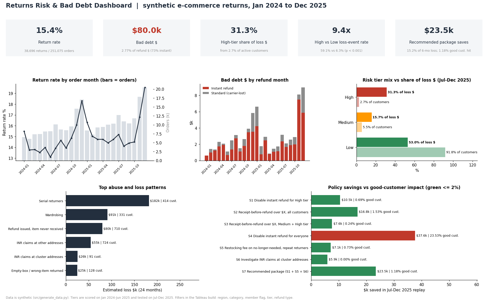

# Data Analytics Portfolio

Seven projects in one place. The first three are built around a returns operation (refund abuse, grading defects, weekly program reporting). The rest are earlier projects that I went back and reworked with SQL, Excel and a short write-up for each.

Each folder stands on its own: README, SQL, Python, Excel workbook, docs and charts. Most rebuild from scratch with `python src/run_all.py`.

## Projects

| Project | What it's about | Headline result |
|---|---|---|
| [Returns Abuse & Bad Debt](./Returns-Abuse-and-Bad-Debt-Analysis/) | Which return behaviors cause refund losses, and which policy fixes them without hurting good customers | High-risk tier is 2.7% of customers but 31.3% of losses. The recommended policy saves 15.2% of loss dollars and touches 1.18% of good customers |
| [DMAIC: Returns Defect Reduction](./DMAIC-Returns-Processing-Defect-Reduction/) | Lean Six Sigma project on returned items getting the wrong disposition | Pilot cut defects from 8.5% to 2.6% (p < 0.001). Network rate went from 6.8% to 3.0%, about $98k a year in recovery value |
| [Returns Program Health & Automated WBR](./Returns-Program-Health-Automated-Reporting/) | One command builds the weekly business review (Excel + PDF) and a program tracker | Traced a refund cycle time miss (3.77 vs 3.30 days) to carrier transit on one channel, not the warehouse |
| [Ride-Hailing Dispatch Optimization](./Optimizing-Ride-Hailing-Services-Uber/) | Simulation comparing first-dispatch and batched driver matching | Batching cut average rider wait by 23.7% and the 90th percentile by 32.5% |
| [Are Action Movies More Successful for Disney?](./Are-Action-Movies-More-Successful-for-Disney-/) | t-test and regression on box office data | Action looks 71% better on raw averages, but the effect disappears once budget is controlled (p = 0.98) |
| [Movie Recommendation](./Movie-Recommendation/) | kNN recommender on MovieLens, plus SQL on rating coverage | 76.6% of movies have under 10 ratings, so only 450 titles are reliable to recommend from |
| [NLP with Transformers](./Transformers_ChatGPT/) | Pretrained Hugging Face pipelines on short text tasks | Zero-shot tagging picked the right topic at 0.997 with no training data |

## Where to find things

| Looking for | Go to |
|---|---|
| SQL (CTEs, window functions, program health queries) | `*/sql/` in any of the first five projects |
| Excel models (SUMIFS, XLOOKUP, what-if tabs, charts) | `*/excel/` |
| Dashboards (Tableau / QuickSight-ready extracts and layout specs) | `*/dashboard/` and `*/screenshots/` |
| Requirement documents | `Returns-Abuse-and-Bad-Debt-Analysis/docs/BRD_Returns_Risk_Dashboard.md`, `Returns-Program-Health-Automated-Reporting/docs/BRD_Returns_Program_Health_Dashboard.md` |
| DMAIC write-up, charter, control plan | `DMAIC-Returns-Processing-Defect-Reduction/docs/` |
| Memos for non-technical readers | `Returns-Abuse-and-Bad-Debt-Analysis/docs/Policy_Recommendation_Memo.md`, `Are-Action-Movies-More-Successful-for-Disney-/docs/Executive_Summary.md` |
| Program plan, RACI, risks, meeting notes | `Returns-Program-Health-Automated-Reporting/docs/` |

## About the data

The three returns projects use synthetic data that I generated with a fixed seed, so every number is reproducible. None of it comes from Amazon or any employer. The ride-hailing project is also a simulation. Disney, MovieLens and the NLP examples use public data.

## Tools

SQL (SQLite, written to port to Redshift or Postgres), Excel, Python (pandas, statsmodels, scipy, matplotlib), Tableau / QuickSight, Lean / DMAIC.

[LinkedIn](https://www.linkedin.com/in/omkar-vyas/)
