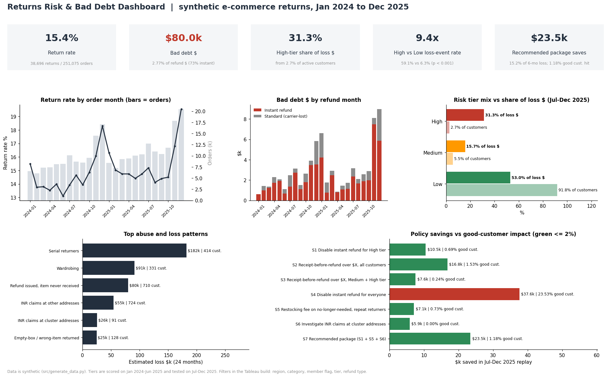

# Returns Abuse and Bad Debt Analysis

I wanted to know which return behaviors actually cost an e-commerce returns program money, and whether those losses can be cut without making things worse for the customers who aren't doing anything wrong. Instant refunds were the obvious suspect. They are part of the story, but it turns out a small group of customers matters more than the refund type.

Built with SQL (SQLite, CTEs, window functions), Python (pandas, statsmodels, scipy, matplotlib) and Excel (SUMIFS, COUNTIFS, XLOOKUP, INDEX/MATCH, a what-if sheet). There's also a Tableau-ready extract and a few Word/PDF write-ups.



## What I found
- Bad debt lands mostly on instant refunds. $80,032 was refunded on items that still hadn't come back 30 days later (2.77% of refund dollars). 73% of that was instant refunds, which go bad at 3.61% compared with 1.69% for standard ones.
- High-risk customers are 2.7% of active customers and 31.3% of loss dollars in the held-out months. 59.1% of them had a loss event, against 6.3% in the Low tier (9.4x, chi-square p < 0.001).
- The biggest loss patterns over 24 months were Serial returners (resale value lost) at $182,119, Wardrobing (used high-value item, fast return) at $90,984, and Refund issued, item never received (bad debt) at $80,032. They overlap, so don't add them up.
- The reason code often doesn't match what shows up at the warehouse. 12.8% of graded "no longer needed" returns were used, damaged, empty or the wrong item. In the logistic regression, an address with clustered INR claims multiplies the odds of a future loss by 11.2x, and a past condition mismatch by 3.6x.
- For context, the return rate is 15.4% overall and 31.8% for Apparel. November and December orders come back at 17.8%, compared with 14.5% the rest of the year.

## What I'd change
Ending instant refunds for everyone is the blunt option. It saves $37,629 but slows refunds for 23.5% of good customers. A targeted package saves less and touches far fewer people: refund-on-receipt for the High tier, a 15% restocking fee on repeat "no longer needed" returns, and an investigation step for INR claims from flagged addresses. Replayed on July to December 2025, it would have saved **$23,453** (15.2% of loss dollars) and touched 1.18% of good customers. The full trade-off table is in the [policy memo](docs/Policy_Recommendation_Memo.md).

## How I worked through it
I loosely followed DMAIC.

1. Define: wrote down the question, metrics and requirements in the [BRD](docs/BRD_Returns_Risk_Dashboard.md).
2. Measure: data-quality checks and cleaning (sql/01-02), then baselines for return rate, cycle time and bad debt (sql/03-06).
3. Analyze: built customer features with 90-day rolling windows (sql/07) and turned them into a points score and tiers (sql/08). Looked at abuse patterns and signup cohorts (sql/12, sql/10), then tested the tiers on months the score never saw (src/stats_analysis.py).
4. Improve: replayed seven policy scenarios and compared $ saved with good customers affected (sql/11). The Excel workbook lets you change the thresholds and watch the numbers move.
5. Control: a dashboard spec with a refresh schedule and a data-quality panel, a weekly status note, and a pilot plan with guardrails.

## What's in the repo
| Piece | Where |
|---|---|
| 12 numbered SQL queries: data quality, return rate, cycle time, bad debt, window-function features, risk tiers, cohorts, policy simulation | [sql/](sql) |
| Statistical checks: chi-square, two-proportion z-tests, logistic regression with odds ratios | [src/stats_analysis.py](src/stats_analysis.py) |
| Notebook that walks through the analysis | [notebooks/analysis.ipynb](notebooks/analysis.ipynb) |
| Excel what-if model (Policy What-If, Summary, Monthly, Tier Lookup tabs) | [excel/Returns_Risk_Model.xlsx](excel/Returns_Risk_Model.xlsx) |
| Dashboard extract, layout spec and a preview render | [dashboard/](dashboard), [screenshots/dashboard.png](screenshots/dashboard.png) |
| Requirements doc with goals, RACI, testable requirements and metric definitions | [docs/BRD_Returns_Risk_Dashboard.md](docs/BRD_Returns_Risk_Dashboard.md) (+ .docx) |
| Policy memo and a weekly status note | [docs/Policy_Recommendation_Memo.md](docs/Policy_Recommendation_Memo.md) (+ .docx, .pdf), [docs/Stakeholder_Status_Update.md](docs/Stakeholder_Status_Update.md) |
| Condition grading and resale recovery by reason code | sql/04 |
| Raw synthetic CSVs, query outputs and metrics.json | data/raw/, data/processed/ |
| One-command rebuild | src/run_all.py |

## How to run
```
python -m venv .venv
.venv\Scripts\activate          (macOS / Linux: source .venv/bin/activate)
pip install -r requirements.txt
python src/run_all.py
```
`run_all.py` rebuilds everything from scratch: the data, the SQLite database, every query, the stats, the Excel workbook, the charts, the docs, and the executed notebook. It takes about 20 seconds. The ~90 MB database is deleted at the end. Run `python src/run_all.py --keep-db` if you want `data/returns.db` around for your own queries or to rerun the notebook.

The SQL targets SQLite 3.45 (CTEs, window functions with RANGE frames). Date math uses `julianday()` and `substr()`. In Redshift or Postgres those become `DATEDIFF` / `DATE_TRUNC`.

## About the data
All data is synthetic (made by src/generate_data.py). None of it comes from Amazon or any employer. The generator uses a fixed seed and creates 20,000 customers and 251,075 clean orders over 24 months, with a Q4 peak. Most customers behave normally. Mixed in are serial returners, wardrobers, empty-box and wrong-item returns, INR claims clustered by address, and instant refunds where the item never ships back. I also added some dirty records on purpose (duplicates, null reason codes, negative prices) so sql/01-02 has something to clean.

License: MIT
