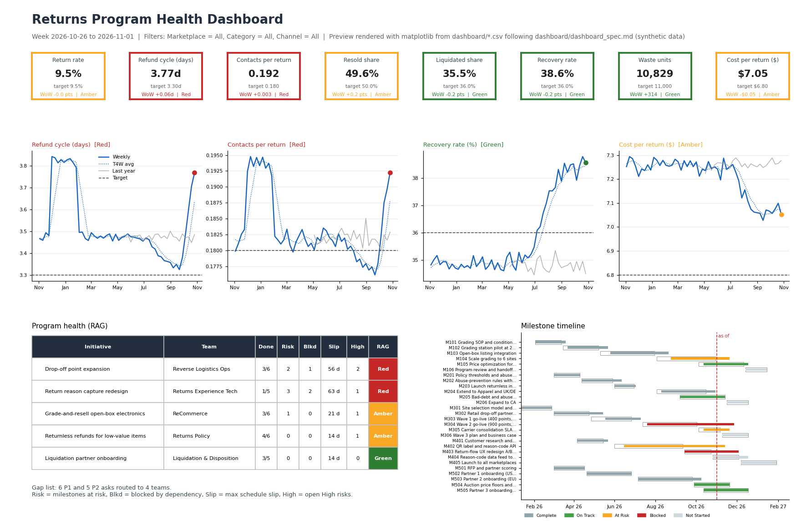
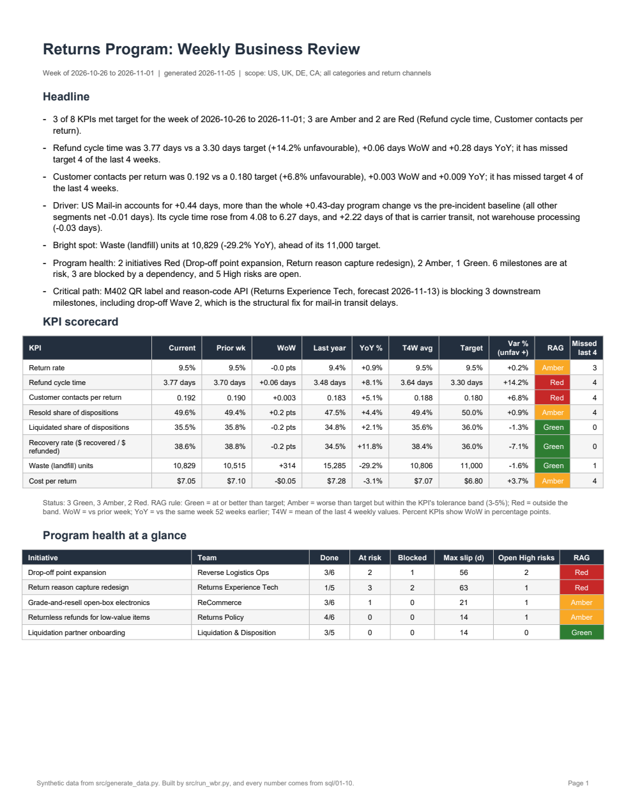
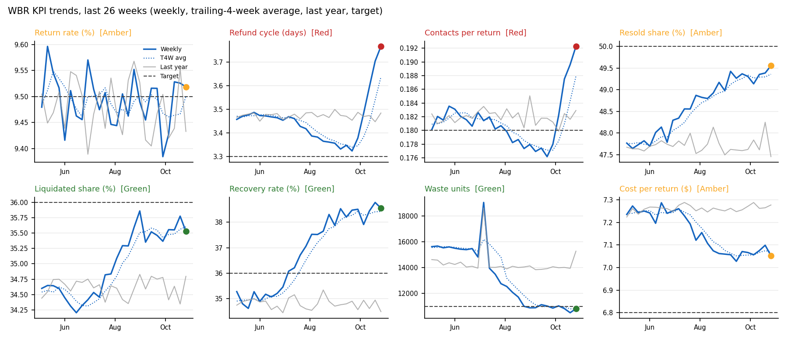
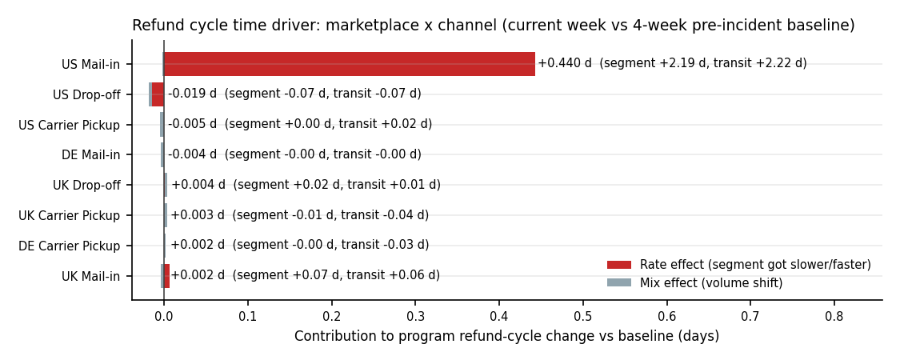
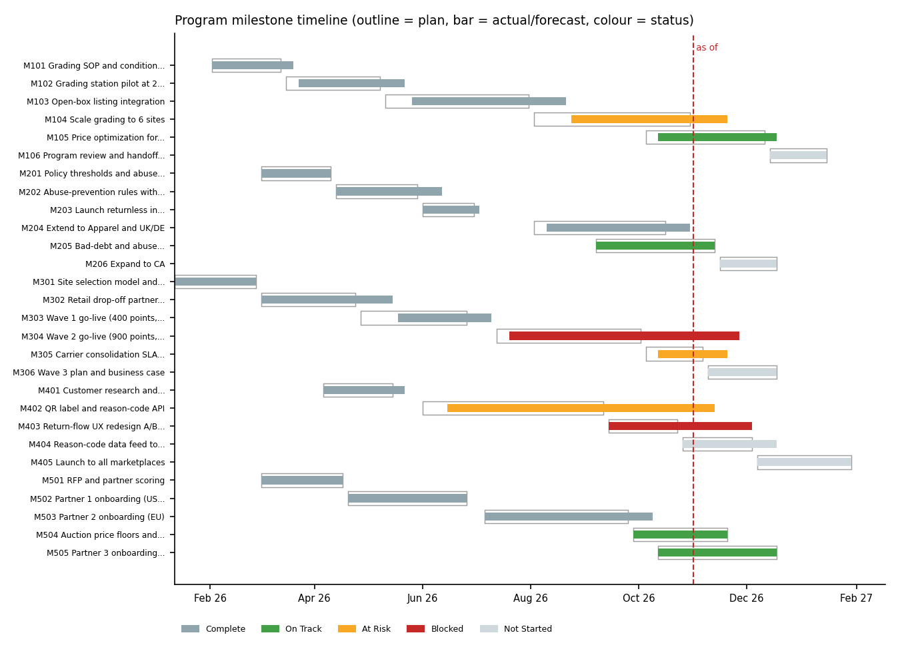

# Returns Program Health and Automated Weekly Business Review

Every week a returns program like this one has the same three questions on the table: are the KPIs on target, are the five initiatives that should move them on schedule, and who owes what before next week. The usual answer is a day of copy-paste across four spreadsheets. I built a pipeline that answers all three from one command and writes the Excel WBR, a 3-page PDF pre-read and a BI extract from the same SQL.

Built with SQLite SQL (CTEs and window functions, written to port to Redshift/Postgres), Python (pandas, openpyxl, reportlab, matplotlib, statsmodels), formula-driven Excel, a Tableau/QuickSight extract and a Jupyter notebook.



*Preview drawn with matplotlib from `dashboard/*.csv`, using the layout in `dashboard/dashboard_spec.md`.*

## What the week of 2026-10-26 to 2026-11-01 shows

- Refund cycle time is Red at 3.77 days against a 3.30 days target (+14.2%), and it has missed 4 of the last 4 weeks. One segment explains it. US Mail-in (20.2% of returns) adds +0.44 days, which is more than the whole +0.43-day program change. Its cycle time went from 4.08 to 6.27 days, and the extra time is carrier transit (+2.22 days), not returns-center processing (-0.03 days).
- Slow refunds show up as customer contacts. Contacts per return is Red at 0.192 vs 0.180. Over 78 weeks, each extra day of refund cycle adds 0.0339 contacts per return (OLS, R-squared 0.96). That works out to about 2,611 excess contacts this week, or $11,749 a week and $610,959 a year at an assumed $4.50 per contact.
- ReCommerce and disposition look good. Recovery rate is 38.6% vs a 36.0% target (+11.8% YoY, Electronics +15.0%), and landfill waste is down to 10,829 units from 15,285 in the same week last year (-29.2%).
- On the program side, 2 of 5 initiatives are Red (Drop-off point expansion, Return reason capture redesign). 6 milestones are at risk and 3 are blocked, all by the same thing: the QR label API (M402), now 63 days late. It also holds up drop-off Wave 2, which is the long-term fix for mail-in transit. 2 High risks (R04, R05) have nobody assigned to mitigate them.
- The run produces the Excel WBR, the PDF with a headline written from the numbers, and a gap list of 6 P1 and 5 P2 asks routed to 4 teams.

## What I'd recommend

1. Escalate the carrier issue (R05) and fix the cause. Getting US Mail-in transit back to its pre-incident level takes program refund cycle time from 3.77 to 3.33 days (-0.44 days). The catch is that this still leaves it just above the 3.30 days target.
2. While the carrier fix lands, pilot refund-at-first-carrier-scan for low-risk US Mail-in customers. The model puts program cycle time at 2.55 days (Green), and it should remove most of the ~2,611 cycle-driven excess contacts a week ($610,959 a year at the assumed rate). It needs an abuse guardrail from the Risk partner, and the returnless-refund rules are a good starting point.
3. Unblock M402 (more engineering capacity, push the phase-2 fields out) so drop-off Wave 2 can launch and pull volume out of mail-in.

## How I worked through it

I loosely followed DMAIC. The BRD (`docs/BRD_Returns_Program_Health_Dashboard.md`) sets out stakeholders, user stories, 13 testable functional requirements and a metric dictionary. For data I generated 18 months of seeded daily records with some dirty rows on purpose, then cleaned them by rule in `src/build_db.py` and logged every fix. The weekly KPI layer (`sql/00-03`) gives WoW, YoY, trailing-4-week average and RAG against target.

For the analysis, `sql/04` ranks category movers and `sql/05` splits the cycle-time change by marketplace x channel into exact rate and mix effects. The notebook (`notebooks/analysis.ipynb`) adds a control chart and the contacts regression. Program health (`sql/06-09`) covers schedule variance, dependency blockers and risk severity, and `sql/10` turns all of it into a gap list with an owner, ask and due date. The control piece is the weekly refresh itself (`src/run_wbr.py`, `src/schedule/`), the weeks-missed-of-last-4 column, and the escalation plan in `docs/`.

## What's in the repo

| Piece | Where |
|---|---|
| SQL for the KPIs and program health | `sql/01-10`: WoW/YoY/T4W, KPI vs target RAG, top movers, rate/mix driver split, schedule variance, blocked dependencies, risk severity, gap list |
| Excel WBR | `excel/Returns_WBR_2026-10-26.xlsx`: summary built on INDEX/MATCH and AVERAGEIFS, editable week/target/amber-band inputs, RAG conditional formatting, 10 native charts |
| Program tracker | `excel/Program_Tracker.xlsx`: XLOOKUP owner lookup, COUNTIFS/AVERAGEIFS/MAXIFS status summary, a Gantt drawn with conditional formatting, stacked bar chart |
| Program plan | `docs/Program_Plan_RACI_Risks.md`: RACI, 28 milestones, risk register, dependencies, DMAIC notes |
| BRD | `docs/BRD_Returns_Program_Health_Dashboard.md` / `.docx` |
| Communication and escalation | `docs/Stakeholder_Communication_Plan.md` (cadence, message templates, L0 to L3 escalation), `docs/meeting_notes_stakeholder_alignment.md` (decisions, action items) |
| Weekly automation | `src/run_wbr.py --week`, `reports/WBR_2026-10-26.pdf`, `src/schedule/` (Task Scheduler and cron) |
| BI dashboard | `dashboard/tableau_extract.csv` and `dashboard/dashboard_spec.md` (calculated fields, layout, Tableau/QuickSight refresh) |
| Driver analysis | `notebooks/analysis.ipynb`: control chart, rate/mix split, contacts regression, sized options |
| Plain-language headline | `src/narrative.py`, which writes page 1 of the PDF (`screenshots/wbr_pdf_page1.png`) |

## Screenshots

| | |
|---|---|
|  |  |
|  |  |

`screenshots/wbr_pdf_page1.png` is page 1 of the generated PDF, rasterized with pypdfium2. `screenshots/top_movers_category.png` has the YoY change by category.

## Repository structure

```
Returns-Program-Health-Automated-Reporting/
  data/raw/            synthetic daily returns + shipments, KPI targets, initiatives, milestones, risks, issues
  data/processed/      query outputs per WBR week, data-quality log, driver analysis summary
  sql/                 00_create_views ... 11_tableau_extract (numbered, each with a header comment)
  src/                 generate_data, build_db, run_sql, run_wbr, narrative, wbr_excel, wbr_pdf, charts,
                       make_tracker_excel, make_dashboard, make_notebook, make_docs, run_all; schedule/
  notebooks/           analysis.ipynb (executed)
  excel/               Returns_WBR_2026-10-26.xlsx, Program_Tracker.xlsx
  reports/             WBR_2026-10-26.pdf, charts/
  dashboard/           tableau_extract.csv (7,800 rows), kpi_weekly_long.csv, program_health.csv, milestones.csv, dashboard_spec.md
  docs/                BRD (md+docx), program plan with RACI and risks (md+docx), communication plan, meeting notes, schedule note
  screenshots/         dashboard preview, PDF page 1, key charts
```

## How to run

```
git clone https://github.com/omkarvyas7/Data-Analytics-Portfolio.git
cd Data-Analytics-Portfolio/Returns-Program-Health-Automated-Reporting
python -m venv .venv && .venv\Scripts\activate      # or source .venv/bin/activate
pip install -r requirements.txt
python src/run_all.py                                 # rebuilds data, db, WBR, workbooks, dashboard, notebook, docs
python src/run_wbr.py --week 2026-10-19               # WBR for any other Monday in the data range
```

To schedule the weekly refresh, use `src/schedule/register_wbr_task.ps1` (Windows Task Scheduler) or `src/schedule/crontab.example` (cron). `docs/schedule_refresh.md` has the details.

The SQL is SQLite. The date functions (`date(x,'weekday 0','-6 days')`, `julianday`) become `DATE_TRUNC('week', x)` and `DATEDIFF` in Redshift, and `GROUP_CONCAT` becomes `LISTAGG`. The rest is plain ANSI.

**Data note:** All data is synthetic (made by `src/generate_data.py` with a fixed seed). None of it comes from Amazon or any employer. I shaped it to look like e-commerce returns, with holiday seasonality, a post-holiday return peak, channel-mix shifts and a carrier-transit incident added on purpose. The roles in the docs are generic role titles and the meeting notes are a made-up sample.
