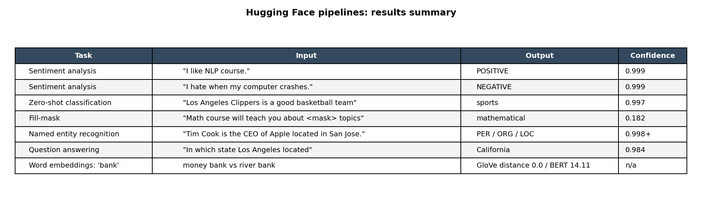

# NLP with Hugging Face Transformers

A quick tour of the pretrained Hugging Face pipelines. I wanted to see how far you get on everyday text tasks (tagging comments, pulling out names, sentiment) without training anything yourself.

Stack: Python, Hugging Face Transformers, Flair (GloVe and BERT embeddings), Google Colab



## Results
- Sentiment got both test sentences right, at 0.999 confidence.
- Zero-shot classification put a basketball sentence under "sports" (0.997) with no labeled examples.
- NER picked out the person, the company and the city in one sentence, each above 0.998.
- GloVe gives "bank" the exact same vector in "deposit money at a bank" and "sat by a river bank" (distance 0.0). BERT separates them (distance 14.11), because it reads the word in context.

## Where this would be useful
Sorting free-text return reasons or survey comments into buckets is the obvious one, since zero-shot doesn't need a labeled set. Sentiment scores on customer feedback are easy to trend over time. The catch: I only tried a few sentences here, so none of this says anything about accuracy on real data.

## Pipelines covered
| Task | Pipeline |
|---|---|
| Sentiment | `sentiment-analysis` |
| Topic tagging, no training data | `zero-shot-classification` |
| Text generation | `text-generation` |
| Fill in the blank | `fill-mask` |
| Named entities | `ner` |
| Question answering | `question-answering` |
| Summarization | `summarization` |
| Word embeddings | Flair GloVe vs BERT |

## Files
```
notebooks/Transformers.ipynb    run in Colab, outputs saved
src/make_results_table.py       draws the summary image
screenshots/results_summary.png
docs/Project_Summary.md
```

## Running it
Open `notebooks/Transformers.ipynb` in Google Colab and run all cells. It installs `transformers` and `flair` and downloads the models, so you need internet.

To redraw just the summary image:
```
git clone https://github.com/omkarvyas7/Data-Analytics-Portfolio.git
cd Data-Analytics-Portfolio/Transformers_ChatGPT
pip install matplotlib==3.9.2
python src/make_results_table.py
```
